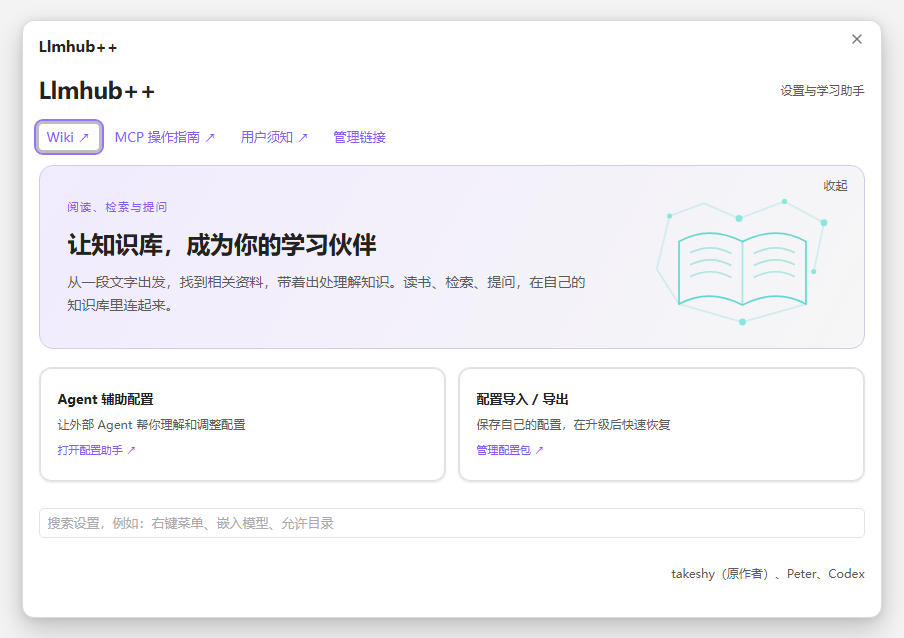
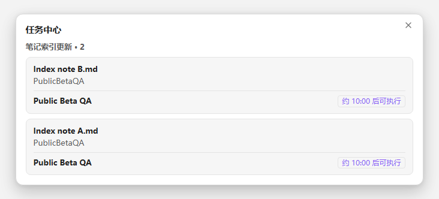

# Llmhub++

**Ask questions about your Obsidian notes and open the supporting passage.** Llmhub++ adds per-note index scheduling, an editable Inbox, Safe Guard, and configuration assistance to LLM Hub.

[简体中文](README.md) · English · [日本語 (earlier guide)](README_ja.md)

[Download](#download-and-install) · [Features](#features) · [Try it with a note](#try-it-with-a-note) · [Feedback and development](#feedback-and-development)

## Features

| What you want to do | What Llmhub++ adds |
| --- | --- |
| Check an answer against your notes | Select an index and use a compatible local or API text model. Open a citation to read the supporting passage. [Grounded answers](resources/help/grounded-answers.md) |
| Keep editing while indexing waits | Each note waits from its latest save. The default is 600 seconds and can be set to 5–900 seconds. The task center shows waiting notes, countdowns, and results. [Indexes and retrieval](resources/help/retrieval.md) |
| Organize new material | Edit the Inbox workflows and scripts to suit your conversion, filing, and indexing steps. [Workflows](resources/help/workflows.md) |
| Control access and outgoing requests | Safe Guard checks requests sent through the local proxy. Set vault permissions, outgoing text rules, and usage budgets where applicable. [Permissions](resources/help/permissions.md) · [Usage and privacy](resources/help/requests.md) |
| Back up settings or use an agent to configure them | Preview and merge configuration bundles by module. An external agent can assist through the local configuration MCP. [Backup and restore](resources/help/configuration-backup.md) · [Configuration MCP](resources/help/mcp-agent-guide.md) |

## Download and install

| File | What it contains |
| --- | --- |
| `llmhubpp-<version>-windows-x64.zip` | Full plugin, offline Wiki, Inbox preset, Safe Guard, and Windows terminal components |
| `SHA256SUMS.txt` | SHA-256 for the ZIP from the same release |

1. Get both files from the same prerelease in [GitHub Releases](https://github.com/Preston-se/llmhubpp/releases). Start with a disposable vault.
2. Extract the ZIP, copy the full `llmhubpp` folder into `.obsidian/plugins/`, then enable Llmhub++ in **Settings → Community plugins**.
3. Open **Llmhub++ → Wiki and help**, or use the English installation guide to connect a model. Back up your settings, indexes, and custom files before upgrading. [Installation and rollback](docs/INSTALL.md)

> [!NOTE]
> The beta package targets Windows x64. The manifest requires Obsidian 1.13.0 or later. Native testing used Windows 10 x64 and Obsidian 1.15.0. Windows 11 and the minimum Obsidian version still need native verification. The offline Wiki articles are in Chinese.

> [!IMPORTANT]
> Everything published so far is a beta. A stable release is promoted from a beta that has already been accepted, with the same files and the same checksums. Until then, the newest prerelease is the version to use. [Release and promotion](docs/RELEASING.md) · [Acceptance checks](docs/RELEASE_ACCEPTANCE.md)

## Try it with a note

1. Connect and verify a text model in **Models and connections**. Set up an embedding service and a small index in **Sources and knowledge bases → Indexes and retrieval**.
2. Create a test note and wait for indexing, or update the index manually. In chat, select the index, enable grounded answers, and ask a question you can check against the note.
3. Open a citation to read the supporting passage. After editing the note, click **Tasks** in the status bar to see its countdown and indexing state.

View the task center example

## Feedback and development

Include the plugin version, Obsidian version, operating system, and the smallest steps that reproduce the issue. [Report an issue](https://github.com/Preston-se/llmhubpp/issues/new/choose) · [Changelog](CHANGELOG.md) · [Build and test](CONTRIBUTING.md) · [Release process](docs/RELEASING.md)

Llmhub++ builds on Takeshi Morita’s (@takeshy) LLM Hub under the MIT license. [Upstream LLM Hub](https://github.com/takeshy/obsidian-llm-hub) · [Credits and third-party notices](NOTICE.md)
