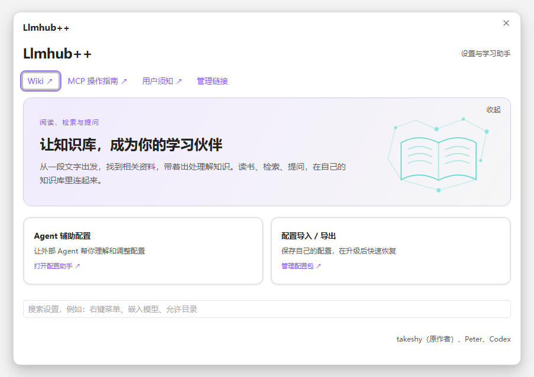
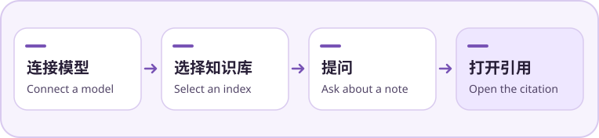
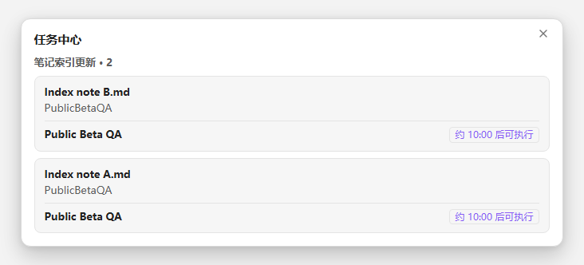

# Llmhub++

**把 Obsidian 笔记连成可追溯的知识库。** 在笔记里提问、点引用回原文，编辑后按笔记更新索引。用可编辑 Inbox 整理资料，用 Safe Guard 和配置助手管理模型、权限和配置。

简体中文 · [English](README.en.md) · [日本語（旧版指南）](README_ja.md)

[下载内测](#下载与安装) · [增强功能](#增强功能) · [从一篇笔记开始](#从一篇笔记开始) · [反馈与开发](#反馈与开发)

## 增强功能

| 你想做什么 | Llmhub++ 提供的能力 |
| --- | --- |
| 按笔记查资料 | 选择一个知识库，用兼容的本地或 API 文本模型提问。点回答引用，回到支持该回答的原文片段。 [知识库问答](resources/help/grounded-answers.md) |
| 编辑时少被打断 | 每篇笔记从最近一次保存开始等待，默认 600 秒，可调为 5–900 秒。任务中心显示待索引、倒计时和处理结果。 [索引与检索](resources/help/retrieval.md) |
| 整理新资料 | Inbox 提供可编辑的工作流和脚本入口。按需要调整原资料转换、归档及派生文本索引。 [工作流](resources/help/workflows.md) |
| 管理模型的访问与发送 | Safe Guard 保护经由本地代理的请求，另有可配置的库内权限、外发策略和用量预算。 [权限](resources/help/permissions.md) · [用量与隐私](resources/help/requests.md) |
| 备份设置或请 Agent 协助 | 配置包按模块合并，应用前预览差异。外部 Agent 可通过本机配置 MCP 查询和协助修改。 [导入与恢复](resources/help/configuration-backup.md) · [配置 MCP](resources/help/mcp-agent-guide.md) |

## 下载与安装

| 文件 | 用途 |
| --- | --- |
| `llmhubpp-<版本>-windows-x64.zip` | 完整插件，含离线 Wiki、Inbox 预设、Safe Guard 和 Windows 终端组件 |
| `SHA256SUMS.txt` | 核对同一版本 ZIP 的 SHA-256 |

1. 从 [GitHub Releases](https://github.com/Preston-se/llmhubpp/releases) 下载同一内测版本的两个文件，先在测试库试装。
2. 解压 ZIP，把完整 `llmhubpp` 文件夹复制到测试库的 `.obsidian/plugins/`，再到 **设置 → 第三方插件** 启用 Llmhub++。
3. 打开 **Llmhub++ → Wiki 与帮助**，按照首次配置指南连接一个已可用的模型。升级已有安装前先备份配置、索引和自定义文件。 [安装、升级与回退](docs/INSTALL.zh-CN.md)

> [!NOTE]
> 当前内测包面向 Windows x64。清单最低要求 Obsidian 1.13.0。原生验收使用 Windows 10 x64 和 Obsidian 1.15.0，Windows 11 与最低版本实机仍待验。

> [!IMPORTANT]
> 现在发布的都是内测版。稳定版从已完成验收的同一次内测晋级，附件和摘要都不变；晋级之前，Releases 里最新的预发行版本就是可用版本。[发布与晋级](docs/RELEASING.md) · [验收项](docs/RELEASE_ACCEPTANCE.md)

## 从一篇笔记开始

1. 在 **模型与连接** 连接并验证一个文本模型，再在 **资料与知识库 → 索引与检索** 配置嵌入服务及小范围索引。
2. 写一篇测试笔记，等待或手动完成索引。在聊天里选择该知识库并启用基于知识库回答，问一个可在笔记里核对的问题。
3. 点击回答中的引用回到原文。编辑笔记后，可在右下角 **任务** 查看该笔记的等待时间与索引状态。 [首次配置](resources/help/first-setup.md)

查看任务中心示例

## 反馈与开发

遇到问题请提供插件版本、Obsidian 版本、系统和最小复现步骤。 [提交问题](https://github.com/Preston-se/llmhubpp/issues/new/choose) · [版本记录](CHANGELOG.md) · [开发与测试](CONTRIBUTING.md) · [发布流程](docs/RELEASING.md)

本项目基于 Takeshi Morita（@takeshy）的 LLM Hub 开发，沿用 MIT 许可。 [上游 LLM Hub](https://github.com/takeshy/obsidian-llm-hub) · [来源与第三方许可](NOTICE.md)
