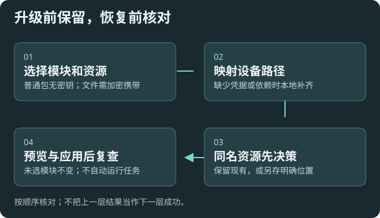

# 配置导出与恢复

适用于升级前备份设置、换设备或恢复本次运行内的误改。普通配置包不包含原资料正文、向量索引、聊天和任务记录，应使用自己的资料备份方式另存。

## 选择要携带什么

1. 打开[配置导入与导出](settings:transfer)，选择模块并导出配置包。
2. 默认不携带密钥；需要携带时在本地填写口令，将凭据单独加密并妥善保管。
3. 自定义预设、脚本、Skills 需主动选资源模块并列出库内路径。携带文件必须加密，防止正文中未识别的秘密进入普通明文包。
4. 保留当前安装和数据，候选版本验收后再决定替换。

## 在原设备或另一设备恢复

选择包，按需本地解锁；核对路径映射、缺失凭据与依赖。同设备匹配密钥不会被“已配置”占位符覆盖；设备 SecretStorage 密钥不随普通包迁移。

加密包在本地输入原口令后才能生成导入预览。未填写或口令错误时会说明原因，当前配置保持原状态。Agent 遇到 LOCAL_PASSWORD_REQUIRED 时应引导你回到此窗口，口令只在本机输入。

MCP 请求包含自定义文件的备份时，会返回 LOCAL_RESOURCE_EXPORT_REQUIRED 并说明本地加密流程。请主动选择真实资源路径；空路径或文件缺失会报告错误，核对文件清单后再把包当作完整备份。

同名资源先选择保留或另存。未选择的模块不变；导入不自动运行脚本、开启配置监听、扫描资料或重建索引。

## 预览、应用与会话恢复

核对差异和待重载项后应用。并发冲突需重读后再预览；口令错误、摘要损坏或不支持的版本在写入前失败。

最近记录可恢复本次运行内的快照；记录可跨重载保留，但内存恢复快照不能假定仍在。已有后续修改时拒绝覆盖；跨重载恢复使用配置包。涉及风险降低保护的恢复先给预览，重新核对授权。

## 验证与失败处理

确认模型引用、目录与自定义文件仍正确，再按结果完成本地重载和连接检查。配置包不是外部工具安装器，也不会替你迁移模型和旧索引。

出现恢复待处理状态，保留事务记录和当前可读配置，停止反复覆盖；见[故障排查](help:troubleshooting)。
