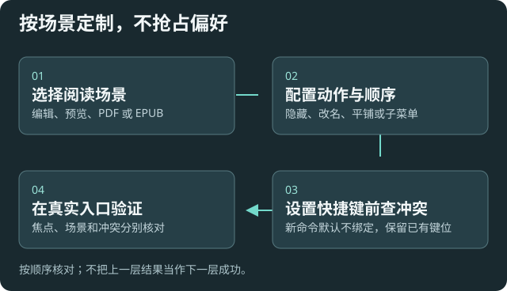

# 按自己的习惯调整界面

适用于阅读菜单、快捷键、帮助入口和聊天历史。建议逐项改，随时核对效果，不重置已有偏好。

## 阅读菜单与快捷键

在[阅读右键菜单](settings:menus)切换整体显示、按场景启停、选择平铺或子菜单，逐项改名、排序或隐藏。数字越小越靠前，名称留空用默认值；恢复默认只影响菜单偏好。

到[快捷键](settings:hotkeys)搜索本插件或动态工作流命令，配置组合键。新命令默认不绑定，已有绑定保留。冲突时先处理宿主报告的占用，插件不会自动抢占；系统和其他应用的快捷键不能全面检测。

## 聊天、历史与语音

在[历史与提示词](settings:history)调整提示词、聊天保存、保留数量和相关目录。保存更多有利于回看，也增加存储；关闭保存前理解后续恢复能力会减少。

[对话与语音](settings:chat)管理发送倾向和语音入口。粘贴即发送、语音发送短语等选项可能触发外发，先用无敏感内容验证。实时语音费用另计，见[用量与隐私](help:requests)。

## 首页与 Wiki

设置页跟随 Obsidian 的界面语言。切换简体中文或英文后重载插件，重新打开设置。内置帮助链接随界面切换，自己填写的链接名称和菜单名称按原文显示。离线 Wiki 文章使用中文。

首页介绍可以收起，帮助链接可新增、隐藏、改名、排序或恢复内置入口。Wiki 提供任务导航、返回、章节目录和设置直达；高级字段放在[附录](help:configuration-fields)。

需要精确字段可打开[精细配置](settings:precision)。先预览差异，再保存，不用整体替换配置来改一个偏好。

## 验证与失败处理

分别在编辑器、阅读预览和实际快捷键入口验证。菜单不存在先看场景开关，快捷键无效先看占用和当前焦点；不要通过清空其他插件绑定解决。

[阅读动作](help:reading) · [Agent 辅助设置](help:mcp-agent-guide)
