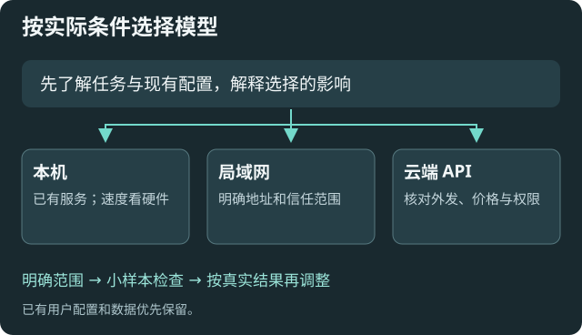

# 首次配置：先确定用途与边界

已有可用配置时，先诊断和补缺项；接入 Agent 不需要重新迁移或恢复默认。

## 选择模型位置

|起点|适合什么情况|先确认什么|
|---|---|---|
|本机模型|希望减少资料出站，已有运行服务|真实协议、地址、模型 ID，以及本机的速度和能力|
|局域网模型|多台设备共用已有服务|明确地址、访问权限；只把信任且不计费的服务认作“本地”|
|云端 API|愿意按服务商条款和价格使用远端能力|资料外发范围、账号权限、费用和密钥保存方式|
|混合使用|不同任务有不同隐私或能力要求|每个任务明确模型，不把失效选择静默替换成另一个服务|

## 打通一个明确服务

1. 在[远程模型服务](settings:api)、[本地模型](settings:local)或[命令行模型](settings:cli)选择对应入口。插件不会安装或下载模型。
2. 填写真实协议和地址。密钥、密码在本地填写；不要贴到聊天或公开笔记。
3. 使用验证/获取模型，选择实际可用模型并保存。手填模型草稿会保留，但不能靠手填“已验证”来伪造可用性。
4. 在聊天中明确选择模型。若尚未授权付费推理，先停在连接和模型列表验证；获得授权后再用一个简单问题评估真实能力。

地址、协议、凭据或 API 代理改变会使原连接验证失效。选择另一个已发现模型不必重新做同一端点的列表检查；列表检查仍不能证明这个模型的视觉、工具或回答质量。

## 先决定隐私与预算

以阅读为主时，建议从库只读开始；只读与禁止外发是两回事。到[发送隐私与用量](settings:requests)选择仅本地、确认、脱敏或沿用原方式，并理解各自影响。

付费服务先核对人民币费率、本月已有支出和希望的上限。硬预算遇到未知费率会拦截；外部 CLI、MCP 和实时语音不计入这套账本。详见[隐私与费用](help:requests)。

## 需要资料问答时再配置索引

到[索引与检索](settings:rag)选择资料范围与嵌入服务。先验证一小份文字资料，查看解析、文件数和分块，再用自己的问题检查召回。已有索引先确认兼容性，不默认重建。

较多候选可能补足证据，也会增加噪声和上下文；较大块保留上下文但定位更粗。数字起点来自程序默认，实际值需按资料验证，见[检索指南](help:retrieval)。

## 验证与失败处理

预期：当前模型身份可解析，连接结果与当前地址匹配，任务能在允许范围内完成，资料引用能回看。保存成功和连接成功分开检查。

列表为空先核对协议、路径、权限和服务是否启动；不要只凭端口推断协议。旧选择失效先修复引用。需要协作时打开[Agent 辅助配置](settings:assistant)，按[五个核心问题](help:agent-onboarding)解释方案。
