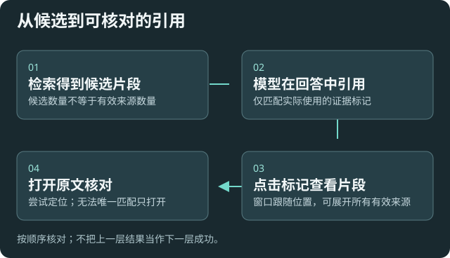

# 资料问答、引用与聊天阅读

适用于围绕教材和笔记提问，同时核对依据、图片和长对话。对话标题表达当前话题；“资源管理器无法浏览”等文字只是示例问题的主题，不是插件的错误状态。

## 让问题有可验证的范围

明确资料、版本和问题，例如“根据这几份笔记比较迁移步骤，指出原文依据”。选择当前知识库，查看真实工具活动和检索结果，不能用模型自述“读过文件”代替实际证据。

支持的本地文本模型和远程文本模型都可以使用「基于知识库回答」。到[对话与语音](settings:chat)可关闭默认开启，或在输入区为当前问题切换。选好知识库与模型后发送。首次遇到缺少知识库或模型受限时，可以保留草稿、改用普通回答或关闭默认开启。没有证据时可以调整问题或检查索引，再从草稿重试。

问答有两次独立的服务选择。嵌入服务收到用于搜索的问题，回答模型收到问题和检索到的摘录。首次向远程服务发送相应用途的资料时，会显示地址并请你选择。相同用途和资料范围沿用选择，仍遵守既有隐私与预算设置。选择了网页搜索、技能或命令时，使用对应入口的发送方式。

回答正文、模型信息和思考过程分层呈现；思考可折叠。操作区按交互显示，避免遮挡连续阅读。

## 从引用回到原文

1. 点击正文引用标记，窗口跟随标记出现，空间足够时默认在下方。
2. 标题显示文件位置，过长会隐藏，悬停/聚焦可查看；相关片段可折叠和滚动。
3. 点击空白处或按 Escape 关闭。窗口内可打开原文，也可查看该次回答所有有效来源。
4. 打开原文或双击标记会尝试跳到相关位置。文件已改动、摘录不唯一或格式不支持精确定位时，可能只打开文件；来源缺失会明确提示。

检索候选不等于有效引用。展示来源依据模型在回答中实际使用的标记及其可匹配证据；未引用或无法匹配的候选不会因“返回了六条”就全部列入。模型仍可能错引，必须回看原文核对。

## 图片预览与输入功能

添加图片后，发送前有整齐的预览，可移除；发送后的用户消息也可回看预览。显示图片不代表当前模型支持视觉，图片外发也不受文字脱敏规则可靠保护。

未发送的文字、附件和读取中状态按聊天保留。切换到另一聊天后使用其自己的草稿，切回可继续编辑。文件会添加到打开文件选择器的聊天，即使选择时已经切到另一聊天。草稿保留在当前聊天视图的内存中，关闭视图或重启插件后需要重新添加。发送历史沿用原保存流程。

附件读取完成后再发送，包括通过技能补全发送。如果在保存问答选择时切换聊天，待发问题会留在原来的草稿里。

点输入区或用键盘进入时展开控件。操作模型、索引或技能菜单时保持展开，点区外或按 Escape 可收起。展开和收起遵循系统的减少动态效果设置。生成时可停止，回车发送、换行等行为以当前界面提示为准。

## 长对话快速跳转

用户提问多于六条后，左侧显示横线导航。悬停展开提问摘要，点击跳到相应轮次；当前阅读位置有反馈。上翻后新内容不会强制抢回底部，可通过“回到最新”继续跟随。

导航找的是这次对话的提问位置，不保证替代全文搜索。保存与恢复历史后，还应核对附件和每轮证据是否完整。

## 检验回答质量

用你熟悉答案的样本检查：引用是否支持陈述、追问是否重新检索、切换知识库后是否混入旧证据。回答空泛先查资料可读性、范围、检索覆盖和真实工具结果，再调整模型或参数。

[索引维护](help:retrieval) · [隐私与费用](help:requests) · [工具范围](settings:workspace)
