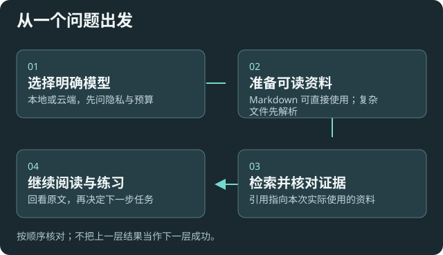

# Llmhub++ 使用指南

从一个真实问题开始：选择合适的模型和资料，核对证据，再逐步扩展自己的使用方式。已有配置、模型、索引和自定义能力优先保留。

## 按任务找入口

|你想做什么|从这里开始|
|---|---|
|第一次配置，或换模型|[首次配置](help:first-setup) · [协作配置的五个问题](help:agent-onboarding)|
|处理 PDF、Office、EPUB 或扫描件|[资料解析与质量检查](help:sources)|
|让编辑后的笔记进入检索|[索引更新与维护](help:retrieval#lifecycle)|
|边读边提问、讲解、对比和练习|[阅读动作与长文](help:reading)|
|核对回答依据、图片和长对话|[资料问答与聊天](help:grounded-answers)|
|限制外发、联网查询和费用|[用量、预算与隐私](help:requests)|
|请外部 Agent 协助设置|[Agent 配置指南](help:mcp-agent-guide)|
|备份配置或恢复到另一设备|[配置导出与恢复](help:configuration-backup)|
|调整菜单、快捷键和历史|[个性化](help:customization)|
|理解权限、目录和扩展|[权限](help:permissions) · [目录](help:storage) · [工作流](help:workflows)|
|排查故障|[故障排查](help:troubleshooting) · [使用边界](help:user-notice)|

## 建议的第一次体验

先用一个明确模型和一份可读资料完成一个问题；检查回答中的引用能否回到原文。结果可信后再扩大资料范围、开启自动更新或增加自动化。

模型列表检查成功，只说明该次连接或元数据检查通过。资料任务结束，也要看正文质量和实际入库结果。不要同时改很多参数来掩盖问题。

## 更多说明

本 Wiki 随插件安装，可离线阅读。模型调用和远端服务仍需对应网络；设置链接会打开本机对应页面。上方“返回”恢复阅读位置，“本页目录”可快速跳转。

[全部配置字段](help:configuration-fields) 是高级附录，需要精确参数时再查看。
