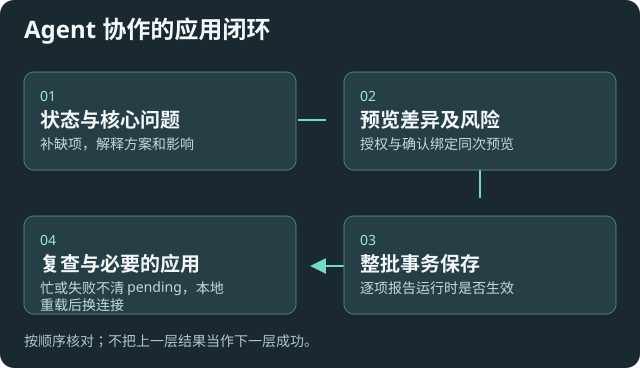

# 请外部 Agent 协助配置插件

适用于让 Agent 理解当前状态、解释选项、生成预览并核对结果。它提供配置接口，不把内容读取、脚本执行或重建索引自动授权给 Agent。

## 在本机建立连接

1. 打开[Agent 辅助配置](settings:assistant)，主动开启本次服务并复制接入信息。
2. 在支持 HTTP MCP 与认证头的客户端添加该服务。按所用客户端版本的文档配置，不把其他产品的语法直接套用。
3. 告诉 Agent：“先看状态，保留我的配置、模型、原索引和自定义能力；解释推荐方案后，在我的授权范围内预览并应用，报告未生效项。”
4. 完成后关闭服务。服务默认关闭；重开、轮换令牌或重载插件会使旧信息失效。

不要把临时认证令牌放入笔记、日志、仓库或公开截图。服务只监听本机随机端口，普通读取不返回密钥；密钥请用户在插件本地填写。

## 空配置时，Agent 应怎样配合

先围绕用途、已有模型位置、隐私、预算和资料范围提问，已知答案不重复问。每项关键选择要解释控制什么、推荐起点、为何适合、不同倾向的影响，以及何时再调；见[协作配置问题表](help:agent-onboarding)。

已有部分配置就补缺项；可用模型存在但当前选择失效时先修复引用，不重新创建服务或重做迁移。推荐只是有条件起点，已有用户值优先保留。

## 15 个工具怎样分工

|任务|工具|结果要怎样理解|
|---|---|---|
|当前状态与引导|configuration_status|默认不联网，未知状态不能当通过|
|严格模型身份|configuration_resolve_model|报告缺依赖、禁用、未验证或过期，不静默回退|
|字段含义与当前值|configuration_describe / configuration_read|优先摘要或精确字段；密钥仅显示配置状态|
|候选地址纯探测|configuration_probe|只模型列表或 HTTP 握手，不保存、不推理、不启动进程|
|已有配置受管检查|configuration_check|可更新验证记录；CLI/MCP 检查可能启动已有程序|
|修复模型引用|configuration_repair|只有明确目标时生成预览，不直接保存|
|预览与应用|configuration_preview / configuration_apply|同一基线的完整事务；高风险需核对授权和回执|
|历史与恢复|configuration_history / configuration_restore|普通恢复直接走原事务；有风险先返回可审阅预览|
|保存结果复查|configuration_verify|持久化、后续变化与运行状态分层；不隐式联网|
|受限运行时应用|configuration_reload|只支持列出的代理/客户端范围，忙或失败保持待应用|
|普通导出与导入预览|configuration_export / configuration_import_preview|无密钥普通包；预览后复用原应用流程|

## 保存后的闭环

先看每项是否已保存，再看运行时生效。监听失败、并发修改或活动任务不能标成功；不能在线应用的按本地步骤处理。需要插件重载时，重新开启临时 MCP 后再复查。

模型列表成功不代表问答、视觉或嵌入质量通过。真正推理和资料任务需在相应授权范围内另验收。

## 给 Agent 的技术附录

保留原有十个工具及有效参数。新查询优先使用 detail=summary 或 fieldPaths；modules 只接受模块名。集合修改用稳定 entityId，不用数组位置。

原资源 llmhubpp://configuration/guide 保留；字段详解使用 describe 给出的 helpUri，按需读取 llmhubpp://docs/field/{path}。模板包括首次配置、死引用修复和合并恢复；只会列工具的客户端也能从 status 开始。

普通配置包通过本机认证上传接口取得句柄，再调用导入预览；20 MiB 上限，服务关闭或轮换后句柄失效。加密包由用户在插件本地解锁，不上传口令。

[全部字段附录](help:configuration-fields) · [配置恢复](help:configuration-backup) · [MCP 协议](https://modelcontextprotocol.io/specification/2025-11-25)
