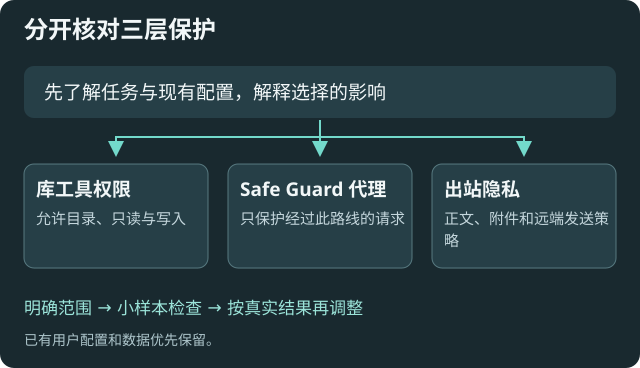

# 工具权限与 Safe Guard

适用于决定模型能读写哪些库内内容，以及理解代理保护和出站策略。权限应匹配任务；模型声称“需要更多权限”不是授权依据。

## 从阅读范围开始

在[仓库访问与工具限制](settings:workspace)核对目录、工具次数和笔记读取上限。阅读任务建议先只读，再按明确的写入任务开放所需范围。更多工具回合允许复杂任务，也可能增加时间和费用。

允许目录越宽，模型可接触资料越多。空列表的含义以该设置说明和实际权限检查为准，不按“空就是禁止”猜测。

## Safe Guard 保护哪条路线

在[Safe Guard](settings:safeGuard)检查只读、代理、视觉路由与上下文参数。它主要保护经过其代理的本地请求；直接连接其他地址仍受各自路径限制，不能等同全机网关。

库只读、代理只读和[发送隐私](help:requests)作用不同。图片视觉路由和上下文压缩可能调用所选模型，需同时理解外发与费用。

显式知识库问答可以在库工具关闭时使用选定索引。首次将问题、摘录或索引内容用于不同的远程服务时，可以在本机确认用途与地址。配置 MCP 可以查看索引等待和暂停状态，发送选择由本机用户决定。可在[用量、预算与发送隐私](settings:requests)重置已记住的选择。

## 保存、生效和重载

一般参数在后续请求中使用；监听地址/端口和部分安装型能力需要应用或重载。MCP 回执逐项区分已保存、已生效、待重载和生效失败，仍保持整批配置事务。

在线代理重载会拒绝正在运行的任务或代理请求，避免中断。只有目标监听实际符合配置才清除待应用项；端口占用、失败或并发修改时继续提示。它不会关闭当前配置 MCP。

无法在线应用的项目需在 Obsidian 本地重载插件；旧临时 MCP 连接失效，重新开启辅助配置并更新连接信息。

## 风险说明与验证

关闭保护、扩大权限、改变上游资料去向、修改进程环境或可执行入口，以及切换凭据存储方式，都需要明确理解影响。Agent 的预览确认回执只绑定该次预览，不证明人类已经同意；普通已授权设置不逐项反复询问。

放宽发送策略、增加可信本地服务、修改正在使用的脱敏规则、关闭硬预算、提高预算或减少本月已用金额时，预览会列出对应影响。收紧保护沿用普通配置流程。保护范围不足时的首次例外选择见[隐私与费用](help:requests)。

用真实工具结果核对拒绝原因与范围；状态“未知”不等于通过。Agent 不能伪造验证结果、索引归属或绕过现有执行权限。

[Agent 配置](help:mcp-agent-guide) · [故障排查](help:troubleshooting)
