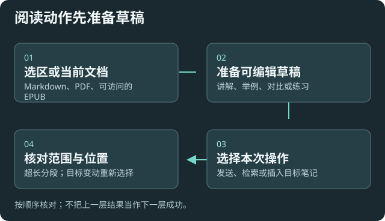

# 阅读时提问、讲解与练习

适用于 Markdown 编辑/预览、内置 PDF，以及可访问选区的 EPUB。先选中当前阅读内容，再决定检索还是围绕原文提问。

## 从选区准备一个问题

1. 选中文字并右键，选择搜索知识库、基于当前资料或基于知识库的入口。
2. 讲解、举例、对比、练习等动作会准备相应草稿；发送前检查内容、来源和所选模型。
3. 检索结果可打开详情、回到原文或插入笔记。来自独立阅读器时，明确选择目标 Markdown 笔记。
4. 插入前确认目标和位置仍有效；目标改变后重新选择，避免写错地方。

## 长文不要只看第一段

读取工具可能分段返回，并附继续读取的位置或说明。内容超限或被截断时，按实际继续标识读取后续段，再总结全文；不要把已读首段当作完整读取。

较小读取上限减少单次负载，也更容易遗漏远处上下文；较大上限增加请求与内存。先用与问题相关的段落，需要全文时明确分段推进。

读取成功不证明模型已理解所有页。扫描 PDF、复杂版式和图片另看[解析质量](help:sources#quality)。

## 结果怎样核对

预期：能在发送前修改草稿，知道使用的是当前选区、当前文档还是检索证据；原文定位准确，无法唯一匹配时会只打开并说明。

用一个短选区、一个长段落和一个 PDF 样本分别验证，再开放批量流程。复杂自动化与写入需要另有授权。

## 选区或菜单不可用时

第三方隔离阅读器可能无法提供选区，可用命令面板或复制文字回退。菜单只显示当前场景适用的动作；名称、顺序、平铺/子菜单和开关见[个性化](help:customization)。

[资料问答与引用](help:grounded-answers) · [工具权限](help:permissions) · [阅读菜单设置](settings:menus)
