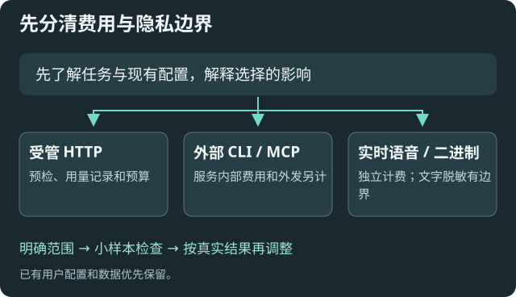

# 用量、预算与发送隐私

适用于控制内置 API 的外发与费用，以及决定本版联网查询的隐私范围。本版不增加网页抓取或把网页自动导入知识库的流程。

## 先看清覆盖范围

|路径|本页能控制什么|需要另外核对什么|
|---|---|---|
|桌面内置模型 API、嵌入和工具回合|用量记录、出站预检和可限制的预算|实际服务商账单、费率与特殊收费|
|外部 CLI、MCP 服务|不承诺覆盖其内部外发或总费用|客户端/服务自身的权限、预算和账单|
|实时语音|不计入此处硬预算|语音服务的独立费用|
|图片、PDF、音视频|文字规则无法可靠处理附件内容|首次说明后由用户决定是否原样发送|
|OpenCode 服务|记录交给服务的请求；后续外发与总费用无法保证|首次选择是否允许，并在服务端核对权限和账单|

## 选择发送倾向

在[用量、预算与发送隐私](settings:requests)选择策略：

- 仅本地：阻止远端请求。回环默认本地；局域网需明确认可完整 origin，只加入受信且不计费的服务。
- 每次检查原文：发送前核对正文；不支持可靠预检的负载会被阻止。
- 规则脱敏：先用合成样本测试替换规则；规则失败停止，不保证发现所有秘密。
- 沿用原方式：不改变外发正文，需理解所选服务和资料范围。

库只读仅限制写入，不等于禁止外发。保护越严格，可用的云端、附件或联网功能可能越少；需要时先说明具体原因，再由用户选择。

## 联网查询为何可能被阻止

托管联网搜索无法预览模型实际生成的查询词，也无法保证所有搜索收费的上限。启用发送保护或硬预算时，首次遇到此情况会解释影响，由你选择阻止或允许并记住。

## 首次提示与记住的选择

当附件无法文字脱敏、服务无法限制输出费用、远端历史费用未知或调用 OpenCode 时，会出现保护范围说明。建议敏感资料选择“阻止并记住”，改用可受控的模型或纯文字输入。若已核对外部服务并愿意承担影响，可选择“允许并记住”。

同一服务、模型、问题类型及保护设置下，后续沿用该选择；更换条件后重新询问。关闭提示等于取消当前调用，下次仍会询问。普通远端请求仍遵守“仅本地”设置，每次原文确认策略仍逐次确认。

允许费用范围例外时，调用会登记为费用未知，并注明处于硬预算管控范围之外。单独允许附件原样发送时，已有费用限制继续生效。外部服务可能继续计费，请按其账单核对。例外选择只由本机用户提示作出，Agent 修改配置不能代替这项决定。

在[用量、预算与发送隐私](settings:requests)点击“重置已记住的选择”，下次将重新询问。验证时使用合成资料，先阻止一次并确认服务端零调用，再重置并允许一次，检查账本中的例外标识。

没有被此处接管的外部 Agent 或 MCP 查询，遵循其自身策略。不能把本插件的账本当作全机网络或费用控制。

## 配好预算再做付费请求

1. 按账号实际价格填写人民币费率与版本；输入、输出、缓存命中、缓存写入和按次搜索分别核对。
2. 填本月上限与启用前已有支出。月份按 UTC，不假定自动汇率或实时价格。
3. 选择输出 Token、工具回合与远程上下文上限。输出越高，预留越多；回合越多，任务更可能完成也更耗时耗费。
4. 开启硬预算后，未知费率或不能可靠限价的请求会拦截；不能把未知当免费。

先保留已有参数。远程上下文上限为零表示沿用原行为；启用后必要时裁掉较早完整轮次，本地历史保留，任务目标和最近工具调用/结果配对保留。仍超限则停止。

## 核对账本与失败

本地记录区分按实报用量计价、未确定估算、预留和未知项，不保存提示正文。中断请求可能仍有服务商费用；按实际账单核对已结束的请求，保留原始记录。运行中的预留不能随意释放。

API 自动重试已关闭，失败后手动决定重试，避免隐性重复支出。验证时先用合成数据与明确限额，再按授权执行真实付费任务。
