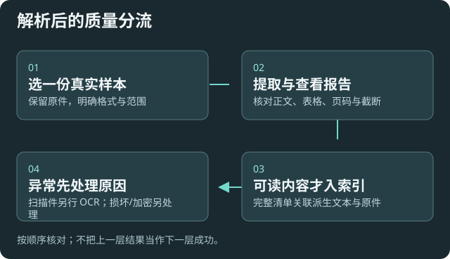

# 资料解析：先确认正文，再扩大范围

适用于 PDF、Office、EPUB 等原资料进入可检索文本的流程。原件、转换文本和索引是不同产物，排错时分别检查。

## 从一份样本开始

1. 在[原资料处理](settings:source)设置目录匹配、包含/排除规则和附件位置；自动监听默认不开启。
2. 手动处理一份代表性文件，观察任务阶段、生成文本、附图和来源关联。
3. 打开转换结果，看标题、段落、表格和页码是否可读，再检查质量报告。
4. 确认后才扩大范围或开启监听。专用转换索引只消费完整清单中的受管 Markdown，不替换原有用户索引。

## 怎样理解质量警告

|情况|应怎样处理|
|---|---|
|能提取文字但正文异常|核对原件，查看警告、截断和处理上限；用不同样本复验|
|扫描 PDF 几乎没有文字|准备可搜索文本或单独授权自己的 OCR 流程；本版不把扫描识别声称为完整 OCR|
|加密、损坏或无法读取|按错误阶段处理原文件，不把“结束”当“成功”|
|超长或超大文件|先检查受限输出与遗漏，必要时分段读取原资料|
|表格或版式复杂|检查单位、列关系和顺序，再决定是否用于问答|

建议先保留原件与派生文本，质量异常时停止扩大处理。提高输出上限可能保留更多内容，也增加内存、耗时和后续上下文；不能用加大限制修复错误解析。

## 自动处理与索引更新

原资料转换监听和笔记索引自动更新是两套开关。前者生成派生内容，后者把匹配笔记的变化写入索引；是否产生嵌入调用，按各自配置决定。

已有预设、Inbox 脚本和路径可以继续编辑、替换或关闭。保存或导入配置不会授权运行脚本、扫描全库、转换或重建索引。

## 核对结果与失败重试

预期：输出可读、有原件来源，索引只收录合格受管产物；取消或失败不冒充完整成功。查看失败阶段和报告后，只重试必要样本。

切换目录前结束相关任务，保留旧目录和自定义脚本。见[目录与继承](help:storage)、[索引维护](help:retrieval#lifecycle)和[故障排查](help:troubleshooting)。
