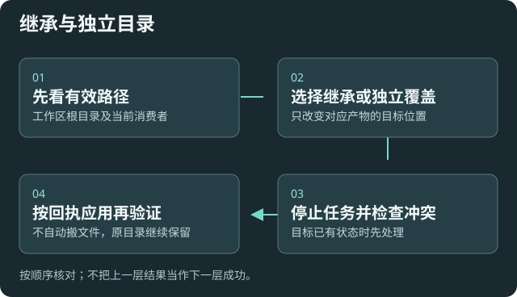

# 目录与继承：先核对位置，再改设置

适用于工作区、工具、Skills、索引、聊天、任务和转换产物的位置。配置包不会代替原资料备份，路径变更也不自动搬文件。

## 继承还是独立目录

在[目录与继承](settings:storage)查看有效路径。继承时随根目录计算；独立目录只改变对应模块的位置。已有旧目录的缺省语义会保留。

建议现有库先沿用当前布局。独立目录便于分类，也增加跨设备映射与依赖核对；仅在有明确管理需要时调整。

## 修改前与应用后

1. 导出[配置包](help:configuration-backup)，另保留资料、索引和聊天备份。
2. 结束相关任务，确认目标没有冲突；已有状态文件会阻止不安全覆盖。
3. 预览有效路径和受影响模块，再保存。按回执完成需要的本地重载。
4. 核对读取与写入消费者的有效位置，再执行新内容任务。

## 跨设备恢复

本机绝对路径需要明确映射，库内相对路径也应核对。设备密钥和外部服务依赖在目标设备另配；不会自动安装工具、复制模型或迁移旧索引。

## 验证与失败处理

用不含隐私的样本确认产物进入预期目录，原目录仍可读。目标冲突、依赖缺失或状态未知时保留现场，不重置插件或删除旧文件。

[凭据存储](settings:credentials) · [配置恢复](help:configuration-backup) · [索引维护](help:retrieval)
