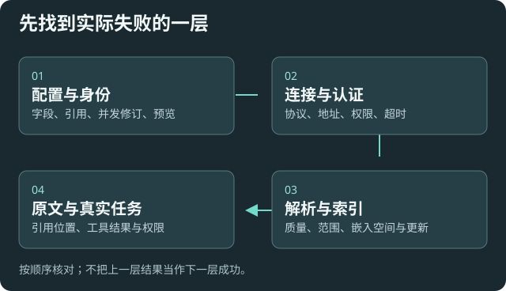

# 从实际失败的环节定位

先保留现场，再区分配置、连接、资料和执行问题。记录真实错误代码与任务阶段，避免用模型自述代替工具结果。

## 模型与 MCP 连接

|看到的情况|下一步|
|---|---|
|模型选择失效|查严格身份，分别处理服务缺失、禁用、模型未启用或验证过期；不静默换模型|
|401/403|本地核对凭据和服务权限，不在聊天贴密钥|
|不可达或超时|确认服务启动、协议、地址、代理；只探测明确目标，不扫描网络|
|模型或搜索服务的 HTTPS 证书校验失败|确认访问的是配置的官方地址，检查当前网络和代理的证书信任，再试一次|
|已允许搜索，但工具失败|查看聊天中的具体原因，分别检查搜索服务连接、API Key、额度或响应|
|上游返回网页或错误 JSON|核对是否填错协议入口，不把 HTTP 成功当模型可用|
|MCP 认证失效|本地重开服务取得当前连接信息；重载/轮换后旧令牌失效|
|探测成功但不能问答|元数据或握手与真实生成不同；按授权另验模型能力|

## 配置事务与运行时

|状态|下一步|
|---|---|
|模块/字段不存在|模块参数只填模块名；精确字段放字段路径，先查询说明|
|预览不存在或过期|重读当前修订并重新预览|
|修订冲突|检查并发修改，不强制覆盖|
|需要风险确认|解释风险、影响及现有授权，使用同一预览回执|
|已保存但待重载|查看逐项状态；按白名单在线应用或本地重载|
|忙（BUSY）|等待任务或代理请求结束，或由用户决定取消|
|端口占用/启动失败|保留待应用，核对本机端口和启动报告；配置 MCP 不因此自动关闭|
|恢复待处理|保留配置和事务记录，先导出可读配置；不清空插件目录|

Agent 可先检查 configuration_status 的 recoveryRequired，再决定是否请求配置修改。精确 fieldPaths 分页读取时，后续请求保留相同路径列表并使用 nextCursor。令牌轮换会拒绝仍在接收正文的旧授权请求；已经进入事务日志提交阶段的操作按事务恢复规则完成。

## 资料解析与检索

没有正文先查原资料可读性和[质量报告](help:sources#quality)。有正文但搜不到，核对选择的知识库、索引更新、范围、嵌入模型和门槛；更换嵌入空间后不能直接沿用不兼容向量。

失败/损坏/旧格式按[生命周期报告](help:retrieval#lifecycle)选择修复范围。只读外部与组合索引需处理来源；不要把只读误判为插件应重建该索引。

引用无法定位，先看原文件是否移动或内容已变；无法唯一匹配时只打开是合理退化。插入目标失效要重新选位置。

## 反馈和安全恢复

反馈包含版本与候选包哈希、操作入口、点击顺序、预期/实际、错误代码及任务阶段。分享前去掉密钥、临时令牌和隐私正文。

未知状态说明缺少证据，需要进一步检查。不要通过关闭保护、删除旧索引、重装模型或覆盖自定义脚本解决不明问题。

[首次配置](help:first-setup) · [权限](help:permissions) · [配置恢复](help:configuration-backup)
