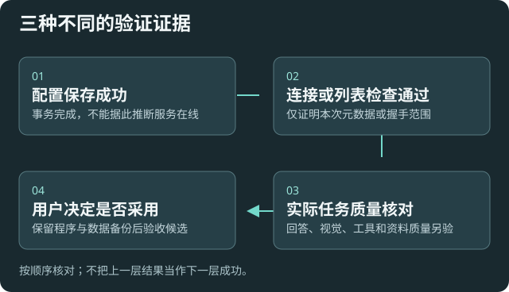

# 使用边界与验收说明

本 Wiki 说明当前功能和可验证边界。自动测试、合成 HTTP 服务和宿主测试不能替代你用真实资料与所选模型验收。

## 保留你的已有工作

接续开发不自动重置配置、迁移原索引、安装或下载模型，也不覆盖自定义脚本和预设。升级前保留程序与资料备份；候选由用户选择安装，不能因打包成功就宣称已验收。

普通配置包不包含全文资料、向量、聊天和任务记录；加密携带秘密或资源由用户在本地选择。新索引更新段的兼容性与旧程序不同，降级前另核对。

## 理解外发与费用

远程模型、嵌入服务与扩展按所选路线工作。只读不等于禁止外发，文字规则不能可靠脱敏图片/PDF。受管 HTTP 账本不覆盖外部 CLI、MCP 与实时语音，不代表服务商实时总账单。

本版联网调整只处理隐私与费用控制，不增加网页抓取入库。

## 区分三种结果

保存配置、通过连接/列表检查、真实任务质量通过，三者不同。状态默认不联网，证据不足时为未知；预览不执行推理、脚本或索引任务。

MCP 提供完整引导和可测试模板，不能保证任意第三方模型都会遵从。实际 Agent 会话和真实资料质量需要单独验收。

## 保护本机接入信息

Agent 配置服务默认关闭，临时监听本机随机端口；重开、轮换或重载会使旧连接失效。不要公开令牌、口令和密钥。高风险回执只约束同次预览，不代替真实授权。

作者：takeshy（原作者）、Peter、Codex。原许可与归属信息随安装包保留。

[功能地图](help:index) · [故障排查](help:troubleshooting)
