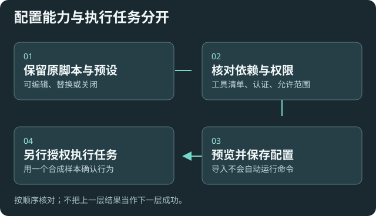

# 工作流、Skills、MCP 与自定义能力

适用于继续使用自己的脚本、提示词、预设、节点和外部能力。配置与运行分开，接入 Agent 不会授权执行这些内容。

## 保留并选择能力

[工作流与可编辑预设](settings:workflow)可打开工作流面板，或编辑库内预设。Inbox 预设可以替换、修改或关闭；自定义文件不自动覆盖。

[斜杠命令](settings:slash)、[技能管理](settings:externalSkills)、[MCP 服务](settings:mcp)和[智能体扩展](settings:agent)分别管理入口与能力来源。不要把“已登记”当作依赖已安装或服务可用。

## 设置倾向与影响

自动批准、事件触发和可执行命令可增加自动化，也扩大不经逐次交互的执行范围。先小范围、明确目标，再决定开启；程序路径指向已有工具，不由插件自动安装。

MCP 的允许工具与自动批准应分别核对。HTTP 服务的认证头、stdio 的环境变量可能含秘密，普通读取隐藏；本地填写与加密备份按需要选择。

### 联网搜索授权

在聊天中启用配置好的搜索 MCP。DeepSeek 搜索首次调用时会显示查询和授权范围，选择「允许并记住」后，此库的其他聊天和模型会复用同一连接和工具的授权。更换服务连接后会重新询问。其他 MCP 工具可选择「仅允许一次」或「始终允许此工具」。

要撤销授权，在 [MCP 服务](settings:mcp) 中编辑对应服务，从「已允许的工具」移除该工具并保存。工具获准后仍需要网络和服务响应。聊天会显示能识别的搜索失败原因，按[连接排查](help:troubleshooting)检查。

## 升级或换设备

在[配置包](help:configuration-backup)主动选择资源模块，并列出明确路径；携带自定义文件需本地加密口令。同名资源选择保留或另存，不自动覆盖用户文件。外部扩展二进制不随配置包打包。

## 验证与失败处理

先检查依赖、可达性和工具清单，再单独授权一个合成任务。CLI/stdio 检查可能启动已配置进程，纯 HTTP 探测不会。外部服务内部费用与外发另行核对。

[编辑历史](settings:edits)可按原功能检查差异与恢复；[加密](settings:encryption)管理原加密与锁定功能，注意口令和恢复方式。[诊断与追踪](settings:langfuse)可能发往所配追踪服务，启用前核对信息范围。

失败时按任务阶段和真实工具结果定位，不通过重置配置、重装能力或覆盖原脚本来试错。
